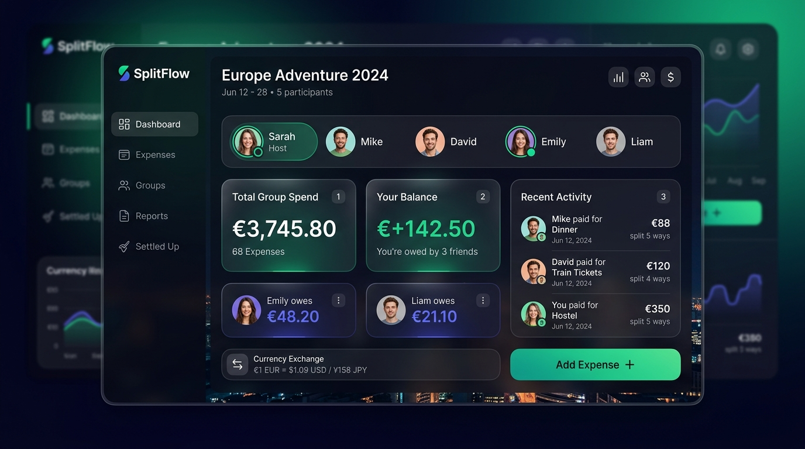
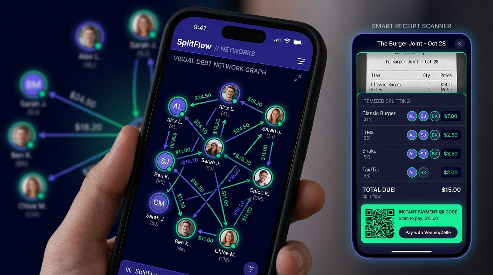
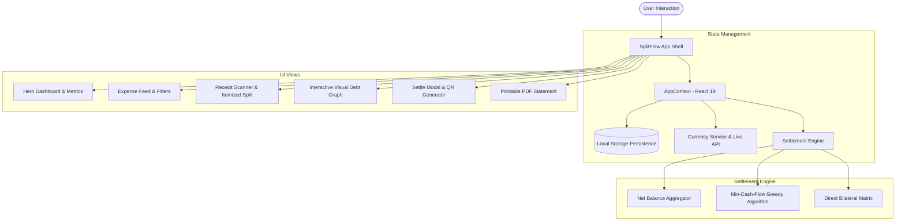

<div align="center">

# ⚡ SplitFlow

**The next-generation group expense splitter with real-time multi-currency conversion, flexible split models, receipt OCR scanner, and graph-simplified debt settlement.**

[](LICENSE)
[](https://react.dev/)
[](https://vitejs.dev/)
[](https://www.exchangerate-api.com/)
[](CONTRIBUTING.md)

<br />



</div>

---

## 📖 Table of Contents
- [Overview](#-overview)
- [Key Features](#-key-features)
  - [1. Fast-Path & Flexible Expense Splits](#1-fast-path--flexible-expense-splits)
  - [2. Multi-Currency Integration with Live API](#2-multi-currency-integration-with-live-api)
  - [3. Interactive Debt Network Graph & Min-Cash-Flow](#3-interactive-debt-network-graph--min-cash-flow)
  - [4. Smart Receipt Scanner & Itemized Bill Splitting](#4-smart-receipt-scanner--itemized-bill-splitting)
  - [5. Dynamic Payment QR Codes & Deep Links](#5-dynamic-payment-qr-codes--deep-links)
  - [6. Recurring Bill & Subscription Tracker](#6-recurring-bill--subscription-tracker)
  - [7. Exportable PDF & Printable Financial Statement](#7-exportable-pdf--printable-financial-statement)
  - [8. Interactive Guest Mode & Multi-User Switcher](#8-interactive-guest-mode--multi-user-switcher)
- [System Architecture](#-system-architecture)
- [Algorithmic Guarantees](#-algorithmic-guarantees)
- [Getting Started](#-getting-started)
- [Project Structure](#-project-structure)
- [Contributing](#-contributing)
- [License](#-license)

---

## 🌟 Overview

**SplitFlow** solves the friction of shared expenses across trips, apartments, dinners, and events. There is no need to make friends download an app or sign up for an account. SplitFlow provides a rich guest mode with live multi-currency exchange rates, mathematical debt simplification, instant payment QR codes, and a receipt scanner.

<div align="center">
  
</div>

---

## ✨ Key Features

### 1. Fast-Path & Flexible Expense Splits
- **5-Second Fast Path**: Typing an expense title automatically detects its category (e.g. *"Shibuya Omakase"* ➔ **Food & Dining**). Default payer is the active user with an equal split across all members.
- **Advanced Split Tabs**:
  - **Equal (`=`)**: Checkbox toggles to include/exclude members with auto-calculated shares.
  - **Exact (`$`)**: Enter precise amounts per person with a live allocation counter and an **Auto-fill Remaining** helper.
  - **Percent (`%`)**: Assign percentage contributions with real-time currency conversion preview and 100% total validation.
  - **Shares (`⚖`)**: Weighted allocation steppers (`+` / `-`) for couples, room sizes, or non-drinkers.

### 2. Multi-Currency Integration with Live API
- Connected to **ExchangeRate-API** (`open.er-api.com`) with 160+ live currency rates.
- Log expenses in any foreign currency (e.g. `¥38,000 JPY`), and SplitFlow instantly normalizes them into the group's base currency (e.g. `≈ $247.56 USD`).
- Built-in resilient offline cache with 1-click rate refresh and custom credit card exchange rate overrides.

### 3. Interactive Debt Network Graph & Min-Cash-Flow
- **Min-Cash-Flow Algorithm**: Solves the maximum flow / minimum cash transaction problem, collapsing complex multi-party debt webs into at most $N-1$ direct transfers.
- **Interactive Visual Graph**: Radial SVG topology showing member nodes with real-time balance badges and animated Bezier vector flows. Click any vector to settle directly!
- **Transparency Switch**: Toggle between **Simplified Debts** and **Detailed Pairwise Balances** for complete audit visibility.

### 4. Smart Receipt Scanner & Itemized Bill Splitting
- **OCR Receipt Simulation & Image Upload**: Upload any restaurant or grocery receipt, or choose from pre-packaged realistic samples.
- **Dish-by-Dish Assignment**: Tap member avatars on individual line items to assign appetizers, entrees, and drinks.
- **Proportional Tax & Tip**: Automatically distributes tax and tip percentages according to each member's dish subtotal.

### 5. Dynamic Payment QR Codes & Deep Links
- Pure client-side SVG QR code generator for **Venmo**, **PayPal**, **UPI (India)**, and **Revolut**.
- **1-Click Deep Links**: Tap *"Open in App"* to jump directly to Venmo or PayPal with recipient handle, amount, and memo prefilled.

### 6. Recurring Bill & Subscription Tracker
- Keep track of recurring expenses like monthly apartment rent, high-speed fiber internet, and streaming services.
- **1-Click Cycle Logging**: Hit the *"Log"* button on any template to instantly generate the expense for the new billing cycle.

### 7. Exportable PDF & Printable Financial Statement
- Generate formal executive financial statements with one click.
- Features executive summaries, member net balance ledgers, simplified payment directions, and complete itemized expense tables.
- Print-optimized CSS (`@media print`) enables clean native `window.print()` PDF exports.

### 8. Interactive Guest Mode & Multi-User Switcher
- Preloaded with 3 rich, realistic sample groups:
  - **Tokyo Adventure 2026 🗼** (Multi-currency trip with JPY & USD)
  - **Apartment 402 Roommates 🏠** (Household rent, fiber internet, utilities)
  - **Amalfi Coast Roadtrip 🍋** (EUR vacation)
- **Perspective Switcher**: Switch the active user viewing the app in 1 click (e.g. view as *Sarah* to see what is owed, or switch to *Kenji* to see what you owe).
- Persistent in `localStorage` with a **Reset Demo Data** button to quickly restore initial state.

---

## 📐 System Architecture



---

## 🧮 Algorithmic Guarantees

### 1. Conservation of Net Balances
For any group with $N$ members and $M$ expenses:
$$\sum_{i=1}^{N} \text{NetBalance}_i = 0$$

### 2. Debt Simplification (Min-Cash-Flow)
Given member net balances, debtors (negative balance) and creditors (positive balance) are matched greedily by magnitude:
$$\text{Transfer} = \min(|\text{DebtorBalance}|, \text{CreditorBalance})$$
This guarantees that all debts are settled in at most $N - 1$ transactions, eliminating round-trips and circular transfers.

### 3. Proportional Tax & Tip Apportionment
For an itemized bill with items subtotal $S_{\text{items}}$, tax amount $T$, tip amount $P$, each member $i$ with item subtotal $s_i$ pays:
$$\text{Share}_i = s_i + (T + P) \times \left(\frac{s_i}{S_{\text{items}}}\right)$$

---

## 🚀 Getting Started

### Prerequisites
- [Node.js](https://nodejs.org/) (v18.0 or higher recommended)
- `npm` or `pnpm`

### Installation

```bash
# 1. Clone the repository
git clone https://github.com/your-username/splitflow.git
cd splitflow

# 2. Install dependencies
npm install

# 3. Start local development server
npm run dev
```

Visit **[http://localhost:5173/](http://localhost:5173/)** in your browser.

### Building for Production

```bash
npm run build
```
The optimized bundle will be compiled into the `dist/` directory.

---

## 📁 Project Structure

```text
├── .github/
│   ├── workflows/ci.yml         # GitHub Actions CI pipeline
│   ├── ISSUE_TEMPLATE/          # Bug & feature request templates
│   └── pull_request_template.md # PR guidelines template
├── docs/
│   └── images/                  # Screenshots and preview assets
├── public/                      # Static web assets
├── src/
│   ├── components/
│   │   ├── analytics/           # Charts, breakdowns & printable statement
│   │   ├── common/              # Avatars, QR generator, toasts
│   │   ├── dashboard/           # Balance banner & metrics hero
│   │   ├── expenses/            # Expense list, itemized OCR modal, recurring
│   │   ├── groups/              # Create group & group settings modals
│   │   ├── layout/              # Navbar, Sidebar & Mobile bottom nav
│   │   ├── profile/             # Profile & perspective switcher
│   │   └── settlements/         # Who owes whom, visual graph, QR & receipts
│   ├── constants/               # Currencies, categories & realistic demo data
│   ├── context/                 # AppContext (centralized reactive store)
│   ├── services/                # Currency API, Web Audio sound, settlement engine
│   ├── styles/                  # Design tokens, index.css, components.css
│   ├── App.jsx                  # Main application layout coordinator
│   └── main.jsx                 # Vite application entry point
├── index.html                   # HTML template with Google Fonts
├── package.json                 # Project dependencies & scripts
├── vite.config.js               # Vite bundler configuration
└── LICENSE                      # MIT License
```

---

## 🤝 Contributing

Contributions, issues, and feature requests are welcome! Feel free to check out the [issues page](https://github.com/your-username/splitflow/issues). Please read our [Contributing Guidelines](CONTRIBUTING.md) before opening a pull request.

---

## 📄 License

This project is licensed under the [MIT License](LICENSE).
